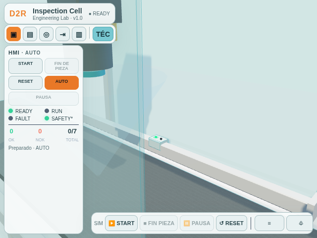
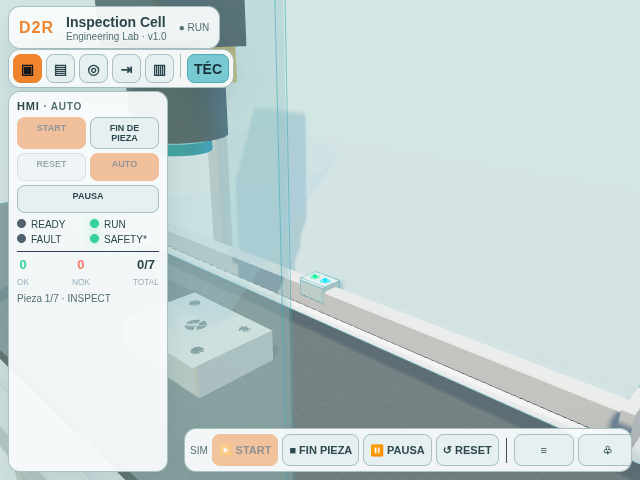

# Vista técnica y sensores compactos

La vista `TÉC` ofrece una presentación clara inspirada en la ilustración aportada: fondo y suelo claros, materiales más mates, protecciones con borde cian fino y sin cuadrícula. El aspecto industrial actual sigue disponible y es el modo inicial. El cambio de estilo también se puede abrir directamente con `?style=technical`.

Los seis sensores visibles usan una carcasa rectangular de `0.16 × 0.09 × 0.12` unidades, sin poste ni esfera grande. Se conserva el tamaño de los LED y se refuerza el contraste con un halo pequeño:

- Verde fijo y halo verde permanente: indicador visual de alimentación simulada; no representa una medición de tensión real.
- Entrada DI en `0`: segundo LED gris apagado, sin halo.
- Entrada DI en `1`: segundo LED cian encendido con halo cian mientras la pieza activa esa señal.

PLC Watch conserva sus etiquetas y posiciones ilustrativas. Seleccionar una fila sigue centrando la cámara en el marcador asociado.

Las capturas siguientes muestran el mismo sensor enfocado en la vista técnica. La primera corresponde a `DI_InspectionPresent=0`; la segunda se tomó después de pulsar START en HMI y alcanzar INSPECT (`DI_InspectionPresent=1`).

No se modificaron fases, duraciones, I/O, contadores, clasificación, trayectorias, lógica PLC ni Safety. No se añadieron dependencias.

## Validación ejecutada

- `tests/check_visual.py`: 28 comprobaciones PASS, incluida la huella de V0, la configuración visual existente, el límite DPR y la ausencia de errores JavaScript.
- `tests/check_controls.py --ui-only`: controles y paneles PASS a 390×844, 960×600 y 640×360; sin errores JavaScript.
- En Chromium, el botón `TÉC` activó el perfil técnico y el control HMI START llevó `DI_InspectionPresent` a `1` al llegar la pieza a inspección.
- Con el sensor seleccionado, el estado de reposo fue `DI_InspectionPresent=0` (señal gris, sin halo); tras clic real en HMI START, INSPECT presentó `DI_InspectionPresent=1` (señal cian con halo). El LED verde y su halo permanecieron visibles en ambos estados; no hubo errores JavaScript.

Las pruebas usan el simulador cinemático y Chromium con renderizado por software. No validan sensores, tensión ni rendimiento de GPU físicos.
