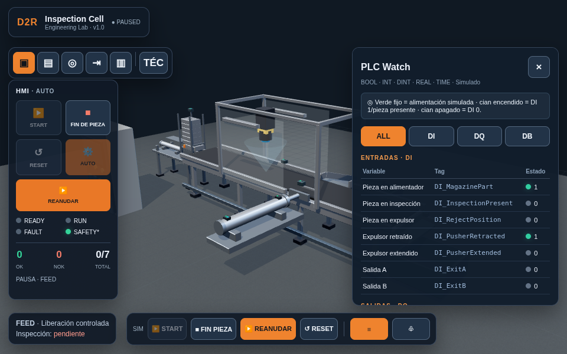
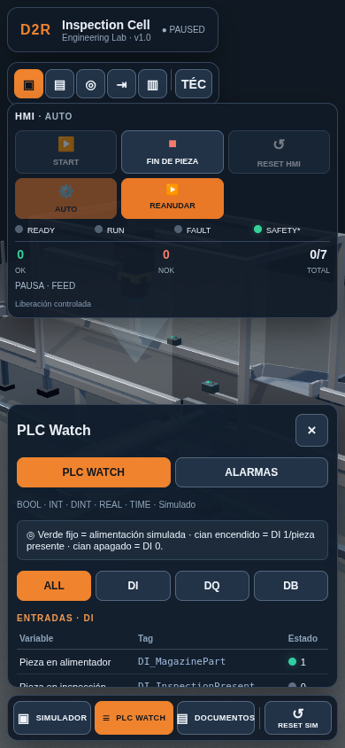

# D2R ENGINE-001 — PLC Engineering Mode

## Alcance y base

Cambios preparados en `feature/d2r-engineering-mode`, creada desde `visual/industrial-v1.3` en el commit `1886f78b022cd469d391cd711c1936db948345ad`. El trabajo queda en una rama de revisión; no modifica `main` ni la web principal de Digital2Real.

Esta etapa retira los mecanismos de inyección artificial F01/F02 del simulador actual. No incorpora módulos formativos ni nuevas condiciones de alarma.

## Auditoría UX y organización didáctica

La captura de la rama mostraba dos superficies con START, FIN DE PIEZA y PAUSA, además de RESET HMI y RESET SIM en posiciones distintas; el aviso de estado inferior se superponía con la barra SIM. La navegación ahora separa tres destinos: **SIMULADOR**, **PLC WATCH** y **DOCUMENTOS**. Los mandos de máquina quedan únicamente en el HMI. Alarmas comparte el panel diagnóstico como pestaña de Watch.

RESET SIM se mantiene como acción de entorno independiente porque puede reiniciar incluso durante marcha; RESET HMI sigue deshabilitado mientras la máquina corre. Sus etiquetas y ayudas explican esa diferencia. Se ocultó el aviso inferior redundante y su resumen de fase/inspección aparece ahora dentro del HMI. Se conservan los cinco encuadres 3D y el selector de estilo técnico.

DOCUMENTOS presenta ocho etapas. El 00 Brief abre como una pestaña interna a pantalla completa, adaptable a móvil y generada desde las fuentes Markdown en español e inglés. El selector ES/EN está en la barra del lector y el PDF usa el idioma seleccionado. Volver cierra el lector y restaura el panel del simulador. Los otros siete documentos siguen pendientes. El brief no es un requisito firmado por un cliente y no se añadieron módulos didácticos.

## Archivos modificados

- `D2R-3D-001_Prototipo_Funcional_v11.html`
- `tests/protected_contract.py`
- `tests/check_visual.py`
- `tests/check_transfer.py`
- `tests/check_controls.py`
- `tests/browser_lab.py`
- `tests/controls-observer.js`
- `tests/transfer-observer.js`
- `docs/evidence/engine-001-interface.png`
- `docs/evidence/engine-001-navigation.png`
- `docs/evidence/engineering-brief-tab-desktop.png`
- `docs/evidence/engineering-brief-tab-mobile.png`
- `docs/engineering/README.md`
- `docs/engineering/00-BRIEF-CLIENTE.md`
- `docs/engineering/00-BRIEF-CLIENTE.en.md`
- `docs/engineering/00-BRIEF-CLIENTE.html` (generado desde el Markdown)
- `scripts/render_engineering_brief.py`
- Este informe.

La referencia V0 en `tests/baseline/V0.html`, su SHA256 y su runner histórico `tests/run_baseline.py` permanecen intactos. Las pruebas dedicadas a F01/F02 que operaban sobre el simulador actual se retiraron de `check_transfer.py`; las comprobaciones históricas de V0 se conservan en su runner.

## Funcionalidades retiradas

Se eliminaron el botón y panel de averías, el selector F01/F02, su botón de rearme y los mensajes específicos de inyección. También se retiraron las ramas que forzaban timeout de cámara o falta de confirmación del expulsor, el latch que congelaba el ciclo para diagnóstico y la congelación de valores Watch asociada a esos snapshots.

No quedan selectores ocultos de avería en la interfaz actual. La prueba de controles ahora comprueba que SIM RESET conserva el panel abierto que el usuario ya tenía seleccionado y no abre un panel de diagnóstico; HMI RESET conserva su comportamiento de reset detenido y cierre del panel actual.

## Funcionalidades y datos conservados

Se mantienen START, STOP al final de pieza, RESET, AUTO/PIEZA, pausa/reanudación, lote continuo, los siete resultados predefinidos, contadores, clasificación OK → A y NOK → B, movimientos de alimentación e inspección, trayectoria NOK y secuencia original. No se alteraron fases, duraciones, señales normales, transforms 3D ni Safety.

PLC Watch conserva los 7 DI, 4 DQ y 5 estados BOOL normales, además de los 9 valores de proceso: 2 INT, 3 DINT, 3 REAL y 1 TIME. Se conservan filtros, selección de sensor y enfoque de cámara. El panel Alarmas y la función genérica de severidad siguen disponibles; no se añadieron condiciones nuevas ni se simularon alarmas de proceso.

## Variables retiradas y motivo

- `fault`: selección local del escenario de inyección F01/F02.
- `faultLatched`: latch usado exclusivamente para detener la secuencia por esas inyecciones.
- `numericFrozen`: bloqueo de actualización que retenía snapshots de diagnóstico.
- `Diag_VisionTimeout` y `Diag_PusherMismatch`: BOOL exclusivos de las dos inyecciones.
- `DB_VisionTimeout`: TIME constante que solo documentaba el timeout artificial F01.
- `latchFault()`: captura de snapshots y mensajes asociados a escenarios artificiales.

Las señales de cámara, expulsor, seguridad y demás variables normales mantienen nombres, tipos, escalas y fórmulas. La conversión de `DB_PieceX` y `DB_PusherPos` permanece igual que en V0; la comparación estática se realiza en el contrato de protección.

## Pruebas y resultados

**Comprobaciones estáticas**

- PASS — sintaxis del módulo JavaScript inline mediante parseo V8, retirando la línea de import de Three.js solo para el parseo.
- PASS — no quedan controles, tags ni ramas de inyección F01/F02 en el HTML actual.
- PASS — lote, fases, registros normales, conversiones Watch, I/O, transiciones, contadores y trayectoria NOK comparan con V0 tras normalizar únicamente los elementos exclusivos de las inyecciones.
- PASS — fórmulas y escalas de `DB_PieceX` y `DB_PusherPos` comparan con V0.

**Chromium / Playwright ejecutado**

- PASS — `tests/check_visual.py`: 31/31 comprobaciones; contrato visual, navegación, cinco vistas, DPR y cero errores JavaScript.
- PASS — `tests/check_feeder.py`: 17/17; avance, retorno, descenso, lote 4 OK/3 NOK, agotamiento sin duplicados y RESET; cero errores JavaScript.
- PASS — `tests/check_transfer.py`: 35/35; llegada, aproximación, contacto, retorno, cuatro OK completos, tres NOK con expulsor retraído y cero errores JavaScript.
- PASS — `tests/check_transfer_geometry.py`: 2/2 verificaciones geométricas sobre muestras reales del ciclo.
- PASS — `tests/check_controls.py --ui-only`: 54/54 en 390×844, 960×600 y 640×360; incluye el selector ES/EN, la pestaña interna, retorno y Escape, responsive, PDF A4 en el idioma elegido, mandos HMI, RESET, Watch y Alarmas; sin errores JavaScript.
- PASS — medición de paneles con Watch abierto: HMI, navegación y diagnóstico sin solapes en los tres tamaños; lienzo 3D presente, cinco vistas y tres destinos; sin errores JavaScript.
- PASS — en la ejecución ampliada pasaron el primer ciclo detenido por STOP, `ENTRE PIEZAS`, anclajes de cilindros y el reinicio de SIM/HMI. También pasó el inicio de modo PIEZA. La ejecución se interrumpió manualmente mientras esperaba la finalización completa de la primera pieza PIEZA: el renderizado software hacía lenta esa espera. El ciclo completo en modo PIEZA queda pendiente; no se registra como aprobado.

**Pendiente**

La finalización completa en modo PIEZA y la segunda orden START permanecen pendientes: la ejecución ampliada seleccionó PIEZA e inició la primera orden, pero se interrumpió durante la espera de fin de ciclo por la lentitud del renderizado software. `tests/run_baseline.py` permanece intacto para la referencia V0 histórica y no reemplaza las comprobaciones del HTML actual.

## Captura, vista web y riesgos





La captura de referencia se tomó en Chromium local a 960×600; la nueva evidencia de navegación muestra el panel Watch, la máquina detrás del HMI y las tres rutas de navegación a 390×844. Una vista privada del simulador se publicó separada de la web principal en [d2r-cell-plc-preview](https://d2r-cell-plc-preview.hillyclef2.chatgpt.site); es accesible al propietario de la cuenta.

La validación se realizó con Chromium y renderizado por software: sirve para comprobar secuencia y geometría observadas, no para estimar el rendimiento en una GPU de usuario ni para afirmar comportamiento físico real. El caso PIEZA sigue pendiente de completar en navegador.

Comandos reproducibles, con `tests/requirements.txt` instalado y Chromium disponible:

```bash
CHROMIUM_PATH=/usr/bin/chromium python tests/check_visual.py
CHROMIUM_PATH=/usr/bin/chromium python tests/check_controls.py
CHROMIUM_PATH=/usr/bin/chromium python tests/check_feeder.py
CHROMIUM_PATH=/usr/bin/chromium python tests/check_transfer_geometry.py
CHROMIUM_PATH=/usr/bin/chromium python tests/check_transfer.py
```
